[](https://stand-with-ukraine.pp.ua)
[](https://github.com/Turskyi/travelling_pro/actions/workflows/android_ci.yml)

[](https://codemagic.io/app/687294b957be760af7e08f04/release-workflow/latest_build)
[](https://wakatime.com/badge/user/f9df5074-b4ea-4c17-b001-fff428ab82aa/project/391a9807-ce03-400e-b236-fb498493db51)


# Travelling Pro

An Android mobile application to help collect all countries that you have
visited and see how many countries visited other members of the app.

## PROJECT SPECIFICATION

• Programming language: [Kotlin](https://kotlinlang.org/);

• SDK: [Android](https://developer.android.com/studio/intro);

• Interface:
[XML](https://developer.android.com/guide/topics/ui/declaring-layout);

• State management approach:
[ViewModel](https://developer.android.com/reference/androidx/lifecycle/ViewModel);

• HTTP client: [Retrofit](https://square.github.io/retrofit/);

• Database: [Firestore](https://firebase.google.com/docs/firestore);

• Dependency injection:
[Koin](https://insert-koin.io/docs/reference/introduction);

• Reactive programming:
[Coroutines](https://developer.android.com/kotlin/coroutines);

• Version control system: [Git](https://git-scm.com);

• Git Hosting Service: [GitHub](https://github.com);

• CI/CD: [GitHub Actions](https://docs.github.com/en/actions) is used to deliver
new Android Package (APK) to
[Firebase App Distribution](https://firebase.google.com/docs/app-distribution)
after every push to the **dev** branch,
[Visual Studio App Center](https://docs.microsoft.com/en-us/appcenter/) is used
to
[deliver](https://appcenter.ms/users/Turskyi/apps/Travelling-Pro/build/branches/master)
new release app bundle to **Google Play** after every push to **master** branch;

• App testing platforms:
[Firebase App Distribution](https://appdistribution.firebase.dev/i/95a4a3bcea0281c7);

• App Store:
[Google Play](https://play.google.com/store/apps/details?id=io.github.turskyi.travellingpro);

• Operating system: [Android](https://www.android.com/);

• Embedded SDK:
[Facebook Sharing](https://developers.facebook.com/docs/sharing/android),
[Facebook Login](https://developers.facebook.com/docs/facebook-login/overview);

• Object storage service:
[Cloud Storage for Firebase](https://firebase.google.com/docs/storage);

• Authentication:
[FirebaseUI for Auth](https://firebase.google.com/docs/auth/android/firebaseui);

• Cloud services:
[Firebase Cloud Messaging](https://firebase.google.com/docs/cloud-messaging);

• Google Play services:
[Location](https://developer.android.com/training/location);

• UI components: [Lottie](https://lottiefiles.com/what-is-lottie),
[PhotoView](https://github.com/Baseflow/PhotoView),
[ViewPager2](https://developer.android.com/jetpack/androidx/releases/viewpager2),
[data chart](https://weeklycoding.com/mpandroidchart/),
[RecyclerView](http://www.recyclerview.org/),
[Loading SVG](https://github.com/corouteam/GlideToVectorYou),
[Glide](https://bumptech.github.io/glide/),
[Data Binding](https://developer.android.com/topic/libraries/data-binding);

• Api: https://restcountries.com/#api-endpoints-v2-all;

• Architecture Components:
[Paging](https://developer.android.com/topic/libraries/architecture/paging),
[LiveData](https://developer.android.com/topic/libraries/architecture/livedata),
[ViewModel](https://developer.android.com/topic/libraries/architecture/viewmodel);

• Architectural pattern:
<br>
<a href="https://en.wikipedia.org/wiki/Model%E2%80%93view%E2%80%93viewmodel">
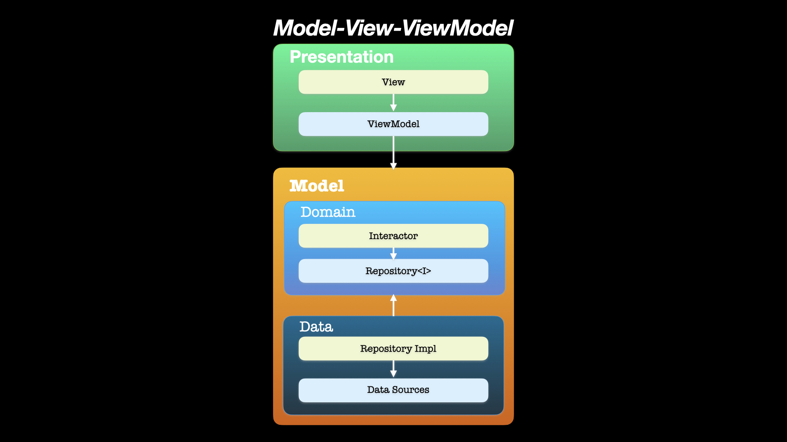
</a>
</br>

• Screenshots:

<!--suppress CheckImageSize -->
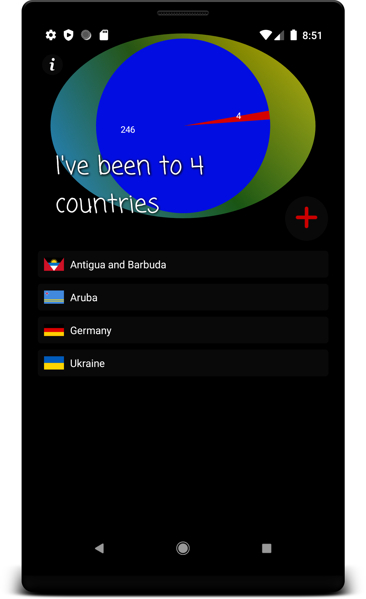
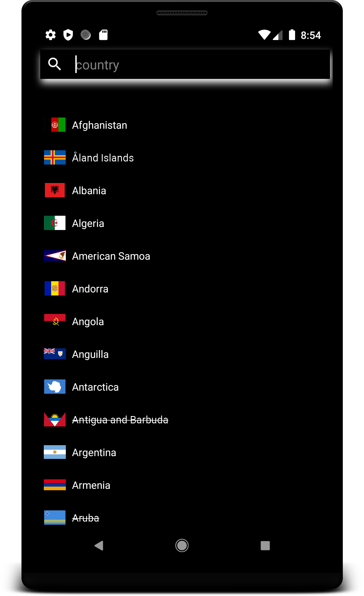
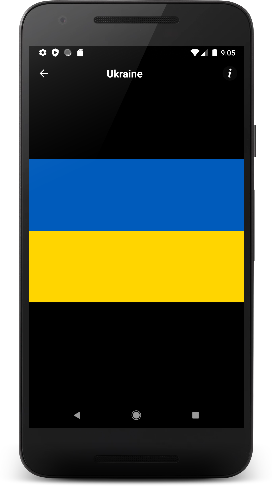
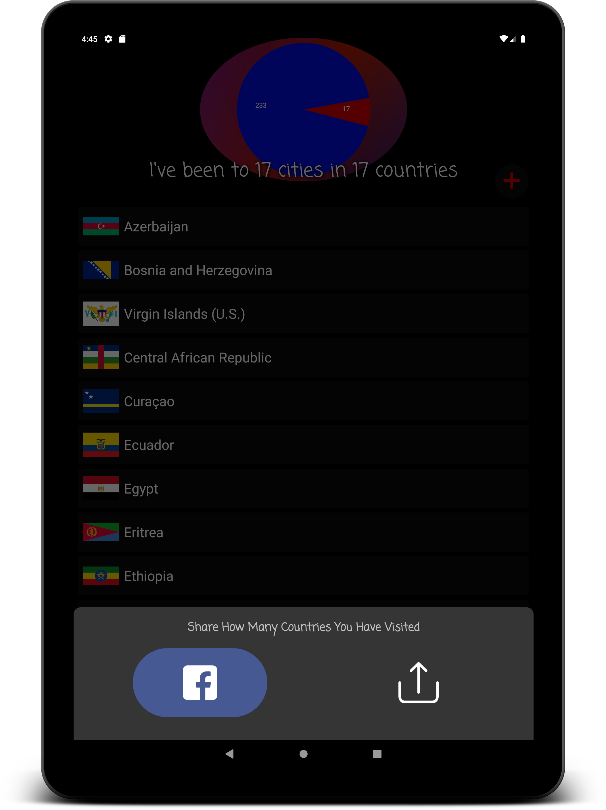
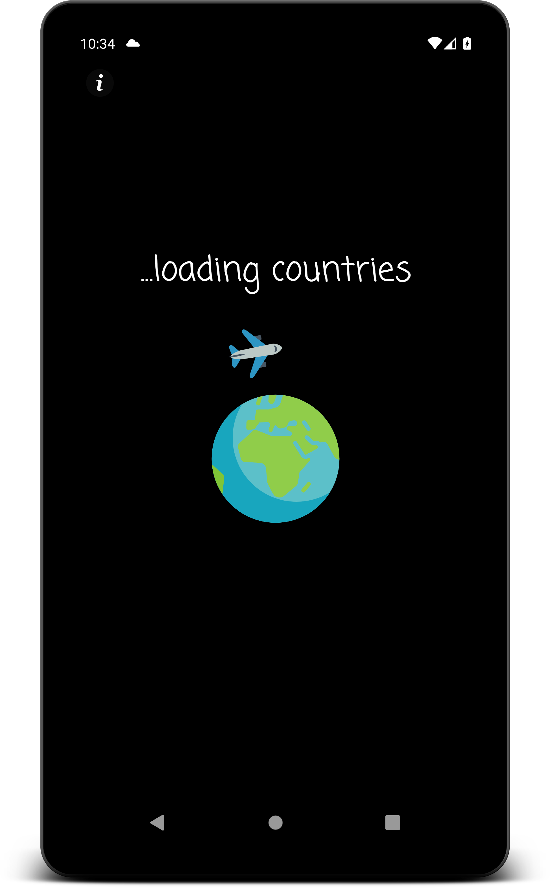
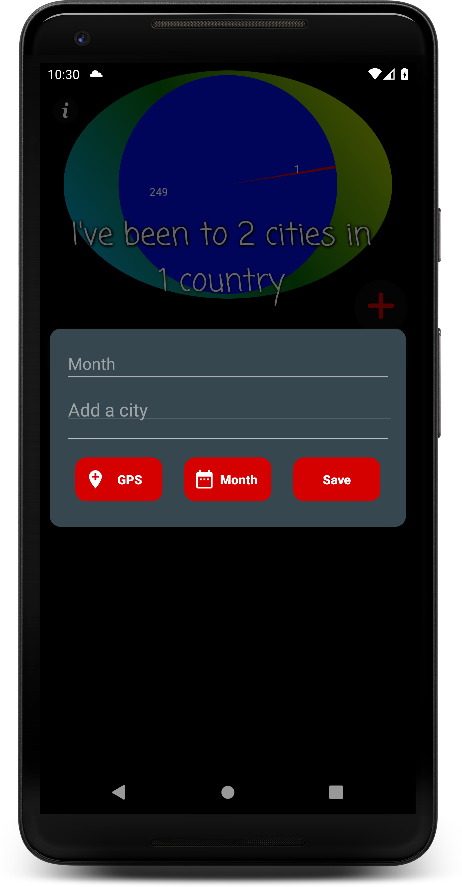
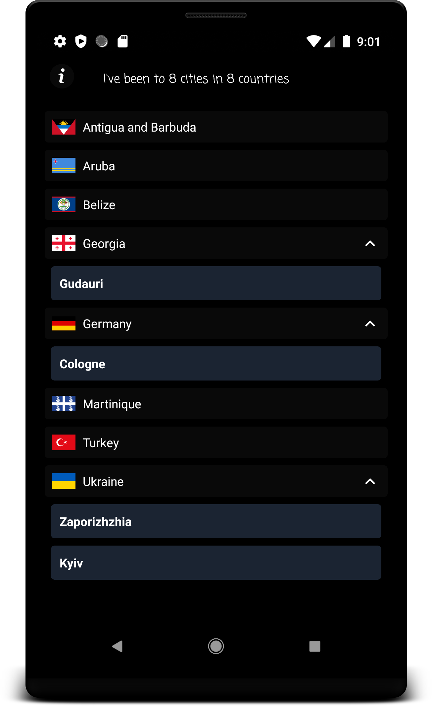

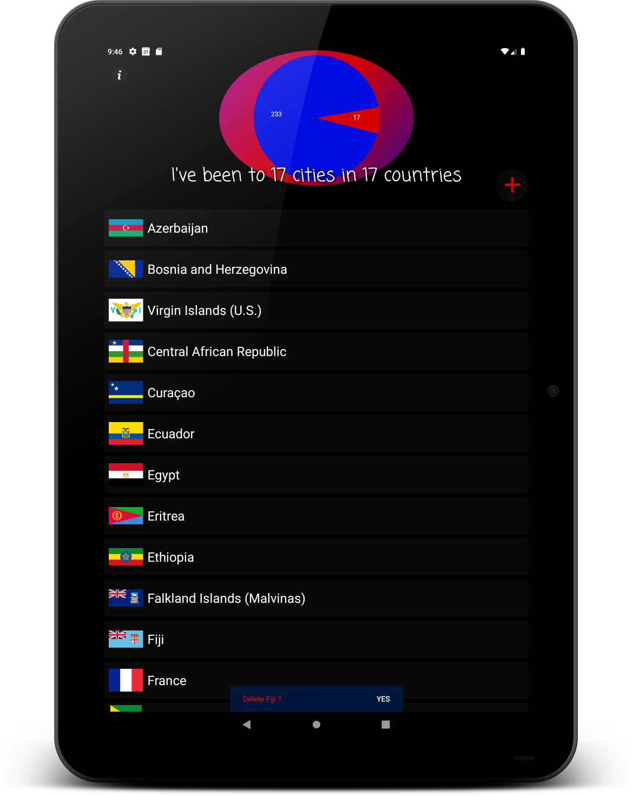
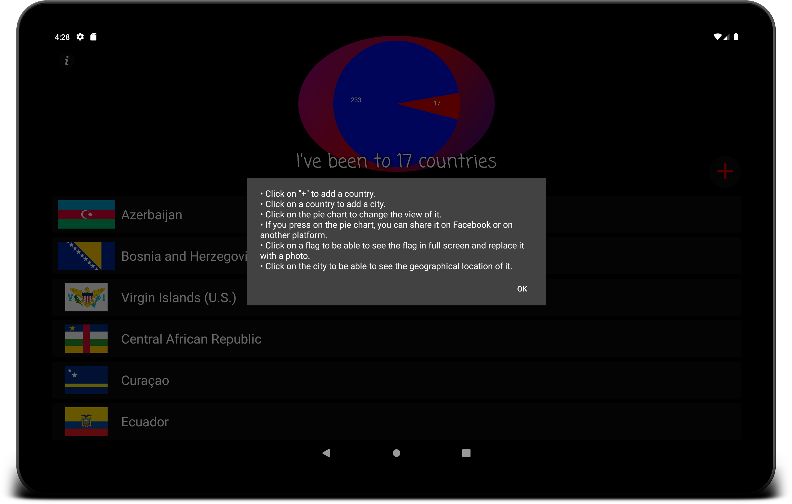

• **Code Readability:** code is easily readable with no unnecessary blank lines,
no unused variables or methods, and no commented-out code, all variables,
methods, and resource IDs are descriptively named such that another developer
reading the code can easily understand their function.

## Cost Control & Billing Management

To temporarily disable billing or unlink your project from Google Cloud Billing (preventing any accidental charges during testing/development):

1. Go to the [Google Cloud Billing Account Management Console](https://console.cloud.google.com/billing/01E8CC-D8671F-7BDD64/manage?project=travelling-the-countries).
2. Scroll down to **Projects linked to this billing account**.
3. Locate your project (`travelling-the-countries`).
4. Click the three-dot menu (**`[⋮]`**) under the **Actions** column next to your project.
5. Click **Disable billing**.

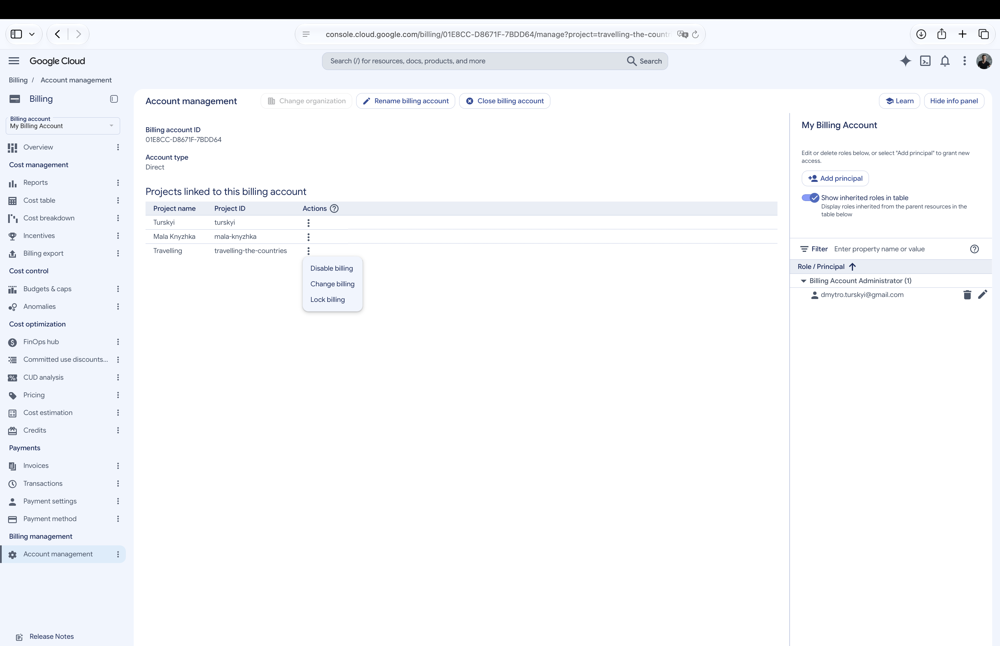

### Firebase Storage Security Rules

The live security rules on the [Firebase Console Rules Editor](https://console.firebase.google.com/project/travelling-the-countries/storage/travelling-the-countries.appspot.com/rules) enforce authentication and a strict 2 MB file size limit to prevent runaway storage costs:

```javascript
rules_version = '2';
service firebase.storage {
  match /b/{bucket}/o {
    match /{allPaths=**} {
      allow read, write: if request.auth != null && request.resource.size < 2 * 1024 * 1024;
    }
  }
}
```

> **Note for Agents**: Keep this snippet synchronized with the live Firebase Console rules if any storage modifications are made.
> **Tip**: The **"Authenticated"** toggle on the left-side Rules Playground simulator in the Firebase console can be ignored or left in either state; it only affects local browser testing simulations and does not alter live rule enforcement on physical devices.

## Download

<a href="https://play.google.com/store/apps/details?id=io.github.turskyi.travellingpro" target="_blank">

</a>
